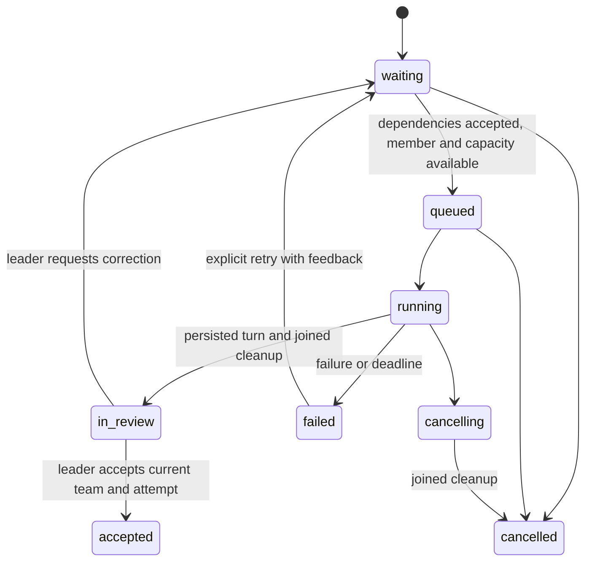

# Agent Teams

Teams extend the existing session, background-task and tool contracts. The leader
is the caller's session. It creates specialists for the current goal, assigns
work, reviews evidence and integrates the result. There is no preset role table,
mandatory planner agent or fixed research/coding/testing pipeline. A specialist's
name, remit and tool subset are supplied by the leader; more members can be added
as new needs emerge. The leader retains its ordinary tools.

## Design Basis

[Claude Code agent teams](https://code.claude.com/docs/en/agent-teams) supplies the
main model: independent conversations, named teammates, shared tasks and direct
communication. Its official documentation describes task claims with file locks,
local JSON mailboxes, dependency admission and automatic message delivery. It also
documents limitations in resuming live teammates and coordinating task completion.
These are documented mechanisms, not access to its private runtime source.

[Qoder's Experts Mode article](https://qoder.com/zh/blog/experts-mode-tech),
published 2026-03-19, describes asynchronous specialists, a leader inbox, a task
DAG and a report/review/dispatch cycle. Its topology routes all communication
through the leader and its product supplies specialized roles. Orangutan adopts
its workflow and verification cycle while keeping roles dynamic and permitting
targeted peer communication. Qoder's quality/cost comparisons are its internal
benchmark claims; they have not been reproduced here.

The reviewed third-party [TaskCreate](https://github.com/Piebald-AI/claude-code-system-prompts/blob/71f578f0b31abf8f3cd1256e88307fcd55b01f32/system-prompts/tool-description-taskcreate.md),
[TaskUpdate](https://github.com/Piebald-AI/claude-code-system-prompts/blob/71f578f0b31abf8f3cd1256e88307fcd55b01f32/system-prompts/tool-description-taskupdate.md)
and [SendMessage](https://github.com/Piebald-AI/claude-code-system-prompts/blob/71f578f0b31abf8f3cd1256e88307fcd55b01f32/system-prompts/tool-description-sendmessage.md)
extractions inform native guidance. Their prompts are not an official
implementation guarantee.

## Responsibilities

| Decision | Owner |
| --- | --- |
| Whether delegation helps; role and task decomposition | Leader model, under the user's goal |
| Global scope, acceptance and corrective work | Leader |
| Local investigation and implementation | Assigned specialist |
| Facts, interface changes, conflicts and questions | Targeted peer messages or reports |
| Ownership, dependency admission, concurrency and terminal state | Runtime |
| External-effect authority | Existing permission and workspace boundaries |
| User delivery, shutdown and process lifetime | Host |

Parallelism is useful for separable questions and deliverables. It is expensive
for tiny sequential edits or several agents repeatedly reading the same files.
The leader should start with the fewest useful specialists and state concrete
deliverables, expected evidence and file ownership. Role instructions themselves
grant no capabilities. A report is evidence for a decision, not proof of quality.

## Runtime And Lifetime

Set `BackgroundTaskOptions::enable_teams = true` when constructing `BackgroundTasks`,
then bind that service to `AgentSessionOptions`. It registers team tools on the
registry and scheduler already used by background AgentRun. The retained Telegram
host enables this; ordinary sessions and hosts without the service do not.

Each owner (session, scope, agent and identity) has at most one current team.
The service retains at most sixteen current boards, each with at most four members,
thirty-two tasks and three execution attempts per task. The parent's child limit
also bounds its roster. Shared background running/queued/record bounds apply to
ordinary jobs and specialist turns together. A busy specialist admits no second
turn. Waiting tasks occupy bounded board state, not coroutines or provider slots.
Admission reserves a result-record slot for each waiting task, so unrelated
background jobs cannot consume the space required by already admitted work.
Capacity exhaustion rejects new tasks/corrections before changing their state.
The ordinary deadline begins on execution-queue admission; time awaiting leader
review is not provider execution.

A member owns fresh agent/session/approval identities and a snapshot of parent
rules. External actions intersect parent and child policies. Tool subsets
intersect configured and host-selected availability. Children cannot use AgentRun
or team-management tools; TeamMessage is explicitly selectable. Visibility never
bypasses dispatch restrictions.

Member sessions persist across tasks and corrections, including without a storage
backend. They share workspace, memory scope, provider route, strand and scheduler.
Shared path locks serialize individual tool effects; they do not isolate whole
edits or resolve semantic conflicts. Assign disjoint write ownership.

Jobs retain member sessions through joined cleanup. TeamStop closes admission,
cancels waiting tasks, requests cancellation of running jobs and suppresses their
pending notifications, including superseded attempts. Running work remains
`cancelling` until cleanup joins. Job transitions update task execution state;
member admission derives from that state rather than a separate busy flag.
Replacement requires a stopped team with no in-flight work. Parent cancellation
targets tasks created/revised by that turn; owner cancellation also closes its
team. Service shutdown closes all teams and joins shared jobs.

Boards, messages and live execution are process-local. Original completed member
transcripts remain in session storage. Replacing a stopped team does not delete
those records. Restart recovery requires durable task/inbox ownership and
interrupted-run settlement. At the board limit, a new owner may evict a stopped,
joined board; live teams are never evicted. Stored transcripts remain intact.
Reopening transcripts alone cannot recover a live team. No operation promises
exactly-once external effects.

## Tools And Task State

| Tool | Contract |
| --- | --- |
| `TeamCreate` | Goal and initial leader-defined `{name, instructions, tools}` roster. No provider work until assignment. |
| `TeamMemberAdd` | Add a dynamic specialist while retaining existing conversations. `leader` is a reserved sender name. |
| `TeamTaskCreate` | Unique key, member, prompt and dependencies on existing keys. Returns immediately. Existing-only edges make cycles impossible. |
| `TeamTaskUpdate` | Exact team ID, key, current attempt, action and feedback. Accept requires a successful report; revise requires a reported/failed task and feedback; cancel starts no replacement. |
| `TeamGet` | Compact board or one retained report with UTF-8 byte paging. Does not wait or acknowledge notification. |
| `TeamMessage` | Recipient, source task key and message. Runtime binds sender and source attempt. |
| `TeamStop` | Close admission and request cancellation, preserving inspection. |

These validated runtime tools use ordinary hooks, durable audit ordering, redacted
input observations and output caps. Models cannot select owner scope or permission
identity. Team IDs reject updates for replaced teams; attempt numbers reject
updates for superseded runs. Foreign and unknown owners receive the same error.

Only `accepted` unlocks dependencies. Reports, notification acknowledgments and
idle members do not. Failed/cancelled prerequisites leave dependents waiting for
leader action. Accepted tasks are immutable; subsequent changes are new corrective
tasks so existing dependency evidence cannot silently change. The required review
note is not interpreted as a test oracle.

Reports retain up to 64 KiB, further bounded by the background result cap. Reads
return up to 8192 bytes and reject interior UTF-8 offsets. Dependency input includes
only relevant accepted reports, with 1024-byte previews, 512-byte review notes and explicit
truncation. Specialists inspect referenced artifacts when previews are incomplete.
Corrections keep the objective and add feedback; retained conversation supplies
earlier work. Starting a correction clears the board's previous report immediately,
including while the new attempt waits for admission. Each member turn's trace
references the parent turn that assigned or revised that work.

The completion inbox coalesces up to four finished runs into one leader turn.
Reports identify team, task and attempt; the leader checks current state before
acting. Automatic acknowledgment follows parent persistence. Query-only hosts
promise no automatic wake. A failed parent turn can leave already executed
task/tool effects, as specified by the ordinary turn contract.

## Direct Messages

Peers exchange information without task-management authority. A member may send
only about its active assignment, to another existing member. The leader may send
task context to any member. There is no broadcast. A team admits sixty-four
messages total and sixteen pending per recipient. Bodies allow 4096 UTF-8 bytes;
encoded envelopes allow 8192 bytes. Overflow enqueues nothing.

Messages enter dynamic conversation before the recipient's next provider request,
after a preceding tool batch has completed. At most two messages and 30 KiB of
encoded input enter one boundary. The sender gets a queued receipt, not a read
acknowledgment. Messages do not interrupt provider calls, split tool exchanges or
wake idle members. Idle members consume messages on their next assignment or
correction turn. There is no automatic ping-pong loop or provider call to check mail.

The frame labels the true sender and source attempt and explicitly rejects
treating agent text as user input, approval or changed user constraints. System
text and native tools stay fixed. Consumption is acknowledged after recipient
persistence; failed turns leave messages pending. A send can survive a later
sender failure, so agents should inspect state rather than duplicate uncertain sends.

## Cost And Cache Strategy

Optimize cost per verified delivery, including failures and repairs. The order is:

1. Avoid delegation without useful parallelism or independent reasoning.
2. Send minimum task context; keep the leader's full history private to its session.
3. Reuse a specialist when prior work remains relevant; use fresh context when
   independence or separation is more valuable.
4. Return concise evidence and artifact references; coalesce ready leader reports.
5. Preserve real stable prefixes, then measure routing and concurrency choices.

The stable prefix contains common instructions, selected memory framing and fixed
specialist operating guidance. Dynamic conversation carries leader-authored role
text, goal, task IDs, dependencies, feedback and messages. Initial goal/remit are
sent once per successfully initialized member. Model/route and tool subset stay
fixed for that member. Changed memory legitimately changes the prefix; retaining
obsolete memory to preserve a hash would be incorrect.

Native tools precede conversational task content on the provider wire. Matching
tool cohorts and common instructions can share prefixes; different tool subsets
need different identities. Unused tools increase input and weaken specialization.
The hash covers submitted system/tool bytes, without agent IDs or artificial versions.

Provider [cache controls](api-portability.md#prompt-caching) remain authoritative.
Anthropic currently marks the stable system/tools prefix; this does not establish
explicit history-cache coverage. Responses supplies a prefix key and relies on
server matching. Local equal hashes establish neither service hits nor portable
KV caches. Model/endpoint changes, provider thresholds, expiry and concurrent
cold starts affect reuse.

Do not serialize useful independent work or issue warm-up calls solely for caches
without measured benefit. A cache write pays off only when subsequent eligible
reads outweigh its premium and added latency. Summarization also costs tokens and
can lose constraints; use existing bounded context compaction instead of another
model call for every report.

Current limits bound members, queued jobs, attempts, messages, iterations and
deadlines. They are not a hard monetary budget. Such a budget needs atomic
in-flight reservations, conservative output bounds, protocol-normalized usage
and explicit unknown pricing/failure usage. Per-role model routing and additional
conversation cache breakpoints require separate provider/composition work.

## Verification And Evaluation

Controlled tests cover dynamic roles, asynchronous work, per-member admission,
dependency review, stale decisions, scope/permission restrictions, continued
transcripts, stable prefixes, peer delivery and joined cleanup. They establish
runtime behavior, not that teams outperform a single model.

Deployment evaluation should compare single-agent, fresh-child and persistent-team
runs with the same task/model/tools and acceptance checks. Include independent
research, parallel edits, a dependent integration check and deliberate rework.
Run cold and warm cache cases and preserve failures. Measure verified completion,
wall time, provider calls, uncached input, cache writes/reads, output, estimated
cost, repair rounds and leader wakeups. Unknown prices/usage stay unknown. Report
success per total spend and cost per successful delivery, not cache percentage
alone. [Live debt](../exec-plans/tech-debt-tracker.md) tracks evaluation and recovery.
