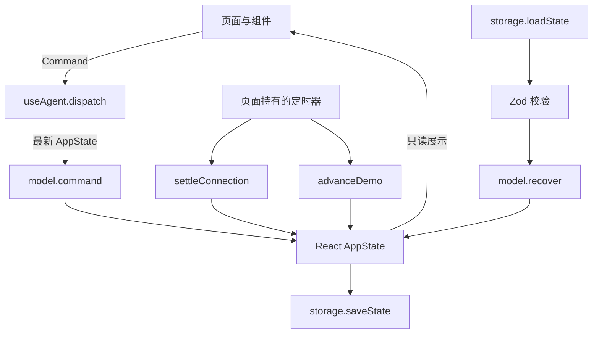

# 桌面 UI 实现与开发接续

本文记录 `apps/desktop` 当前的实现结构、约束和扩展入口，供后续开发直接接续。
[产品需求](../product-specs/desktop-prototype.md) 拥有交互范围和视觉方向；
[应用 README](../../apps/desktop/README.md) 拥有启动、演示操作和验证命令。
本文件不定义尚未实现的服务协议，也不把前端演示当作运行时能力。

## 1. 接手时先确认的事实

- 当前是 React、TypeScript、Vite 浏览器原型，与 C++ 构建和运行时相互独立。
- 五个页面已经可交互：助手、任务、连接、记忆、设置。无需模型密钥即可运行。
- 本地会话可发送、审批、停止和重试；外部渠道在桌面上只读，包括其任务、小队和审批。
- 连接的配置与启停是单独的生命周期操作，不授予桌面对渠道会话的执行权。
- 请求者是消息来源，没有组织成员或管理员角色管理系统；不同渠道身份不自动合并。
- 公共基础记忆与工作区共享，个人记忆按请求者区分；查看渠道消息不把它加入本地上下文。
- 页面关闭即结束演示执行。开发服务器可以继续提供网页，但它不是后台 agent 服务。
- 当前视觉基线是近白开放画布、浅雾色导航与少量铜棕色；用留白和柔和表面区分内容，品牌采用成年红毛猩猩侧面剪影，不使用表情吉祥物或装饰卡片。

后续改动先遵循仓库的 STATUS、ROADMAP、ARCHITECTURE 和相应契约，再确定完整实施切片。
新的原生宿主、真实模型或渠道接入应先提交执行计划。

## 2. 代码地图

以下路径均相对于 `apps/desktop`。依赖版本和许可证由
[依赖文档](../rules/libraries.md) 与 package manifest、锁文件共同记录。

| 文件 | 当前职责 | 修改入口 |
| --- | --- | --- |
| [src/main.tsx](../../apps/desktop/src/main.tsx) | 挂载 React StrictMode 和样式。 | 应用启动。 |
| [src/App.tsx](../../apps/desktop/src/App.tsx) | 侧栏、页面导航、主题与语言、搜索、通知、全局弹层和任务面板。 | 应用壳与页面间跳转。 |
| [src/context.ts](../../apps/desktop/src/context.ts) | 向子组件提供状态、命令派发、翻译函数和导航回调。 | UI 组合接口，不是通用事件总线。 |
| [src/Assistant.tsx](../../apps/desktop/src/Assistant.tsx) | 空白会话、Composer、会话记录、任务卡、审批和渠道只读提示。 | 对话、输入和最近任务。 |
| [src/Pages.tsx](../../apps/desktop/src/Pages.tsx) | 任务筛选、连接配置、记忆编辑、设置。 | 其他四个页面的功能。 |
| [src/TaskPanel.tsx](../../apps/desktop/src/TaskPanel.tsx) | 成果、进度、小队三个视图，以及所属本地任务的控制。 | 任务检查和成果呈现。 |
| [src/components.tsx](../../apps/desktop/src/components.tsx) | 状态标签、来源、任务卡、审批卡、弹层、图标和 Markdown 加载边界。 | 共享显示组件。 |
| [src/RichText.tsx](../../apps/desktop/src/RichText.tsx) | 按需加载的 Markdown/GFM 渲染，跳过原始 HTML。 | 内容呈现，不执行工具。 |
| [src/schema.ts](../../apps/desktop/src/schema.ts) | Zod 结构、关联校验、类型推导与复合键编码。 | 状态结构及快照读取校验。 |
| [src/model.ts](../../apps/desktop/src/model.ts) | 纯命令变换、演示推进、通知去重与恢复变换。 | 状态行为；不访问 DOM、网络或存储。 |
| [src/fixtures.ts](../../apps/desktop/src/fixtures.ts) | 初始连接、会话、任务、消息、记忆及成果。 | 修改演示内容；不重写已有快照。 |
| [src/storage.ts](../../apps/desktop/src/storage.ts) | 快照读取、验证、保存和重置前备份。 | 浏览器存储效果。 |
| [src/useAgent.ts](../../apps/desktop/src/useAgent.ts) | 状态所有权、命令调用、定时器、保存效果、页面生命周期和导出。 | 当前 UI 与演示状态之间的效果边界。 |
| [src/styles.css](../../apps/desktop/src/styles.css) | 主题 token、应用壳、对话、数据页、弹层和响应式布局。 | 视觉调整；已有分区注释。 |
| [public/orangutan.svg](../../apps/desktop/public/orangutan.svg) | 共享品牌标记和 favicon。 | 使用代码原生 SVG 修改。 |

当前没有 URL 路由、第三方全局状态库、WebSocket、HTTP 后端或 C++ sidecar。
不要把示例模型下拉框、连接成功状态或成果路径解释为真实连接、认证或文件操作。

## 3. 数据流与状态所有权

`useAgent` 用 `useState` 保存应用状态；命令和 tick 都通过函数式 `setState(previous => …)`
使用最新值。组件不直接改写数组，也不自行推进任务。无效命令通常返回原状态对象，
当前没有结构化的命令错误返回值。

持久化内容包含 `settings`、`selectedId`、`drafts`、连接、会话、消息、任务、记忆和通知。
以下状态只属于当前 UI：页面 `view`、打开的任务 ID、侧栏、弹层、搜索词、toast，
以及页面内部筛选、编辑草稿、成果标签页。刷新后默认进入助手页，保留选中会话和输入草稿，
不恢复之前打开的设置页、弹层或面板标签。

### 身份和关联

`conversationKey(connectionId, locator)` 与 `requesterKey(connectionId, senderId)`
分别使用 `JSON.stringify([a, b])` 编码。不要改成平台名、昵称或容易碰撞的分隔符拼接。
一个连接 ID 对应一个平台上的接入账号；同平台第二个账号仍是不同连接。

- `Conversation` 记录 `origin`、连接、定位符、请求者、session、显示名和未读数。
- `Message` 显式记录会话、session、角色、内容、时间和流式状态。
- `Task` 显式记录会话、请求者、session、执行尝试、成员、审批和成果。
- `Note` 记录共享或个人作用域；共享记录 `ownerId=null`，个人记录有独立请求者 ID。
- `Notification` 关联源事件、会话与任务；已读状态与任务状态分开。

`stateSchema` 校验对象字段、集合内 ID 唯一性、选中会话存在、会话复合键、渠道引用、
消息所属会话、任务与会话的请求者/session 一致性，以及记忆作用域与 owner 的对应关系。
它用于加载本地快照，不是完整的外部输入认证或服务授权协议。

当前 `Conversation` 只带一个 `requesterId`，任务校验要求与它相同。
群聊中多个发送者共用一个聊天记录的完整模型尚未实现；接入群聊时须显式扩展参与者和任务发起者，
不能直接复用私聊假设。同一入口历史上多个 session 的完整浏览和路由也尚未实现。

## 4. 命令和观察边界

| 入口 | 当前行为 |
| --- | --- |
| `select` | 切换选中会话并清零该会话未读数。 |
| `new` | 创建新的本地会话；不清除其他历史。 |
| `draft` / `send` | 仅接受本地会话。发送拒绝空文本、重复任务 ID 或同会话已有活跃任务的情况。 |
| `stop` / `retry` | 仅控制本地任务。重试限定失败、取消或中断任务，且同会话不得另有活跃执行。 |
| `approve` / `reject` | 仅处理本地任务的当前 pending 审批，要求审批 ID 匹配。 |
| `settings` | 合并当前设置；文件权限选项只参与本地文件演示判断。 |
| `connect` / `disconnect` | 更新连接及其 attempt，不改写渠道任务或审批。 |
| `note-save` | 更新已存在的记录，禁止借编辑改变 scope/owner，拒绝空标题和内容。 |
| `note-delete` | 仅移除指定记录。 |
| `read-notification` | 只改变通知已读标记。 |

`canControl` 判断会话 `origin === 'desktop'`。隐藏输入框和按钮只是显示层，
对应命令也会拒绝渠道写操作。新增快捷键、批量操作和上下文菜单必须复用同一边界。
记忆编辑是单独的功能，不修改渠道消息、任务或权限；原型允许管理当前展示的记忆记录。

`advanceDemo` 和 `settleConnection` 属于演示观察路径，不在公开给组件的 `Command` 中。
它们可以推进所属渠道的演示状态；这不表示桌面用户获得了渠道控制权。
真实接入时需把“宿主发布的观察事件”与“用户请求执行的命令”继续分开，且由宿主验证权限。

## 5. 演示执行的具体行为

### 发送与执行尝试

Composer 产生任务 ID 和时间，`send` 写入用户消息、创建 queued 任务并清空所属草稿。
没有历史的会话使用首条文本的前一部分作为显示名。任务分类使用简单关键词：
文件/整理类优先，其次计划/调研/小队类，其余作为普通聊天。
失败关键词、偏好关键词和固定回复均在 `model.ts`，是可替换的演示实现。

活跃状态由 `active` 统一定义：queued、running、awaiting_approval、cancelling。
一个会话同时只能有一个活跃任务，其他会话可以继续推进。
输出消息 ID 包含任务与 attempt，观察数据按所属任务写回，不依赖当前 UI 选中的会话。

### 定时器与状态机

`useAgent` 持有一个 700 ms 定时器，每次先结算 connecting 连接，再推进活跃任务。
连接结算会核对 attempt 和 connecting 状态，通过显式 `simulateFailure` 选择成功或错误。
断开连接会使旧连接回调失效；不会等价地取消该渠道任务。

`advanceDemo` 先拒绝旧 attempt、终态以及 waiting approval 的推进。
渠道任务只有连接为 connected 时才接收演示推进；这一点只是演示调度方式，
不能据此推断真实运行时在 transport 断开时也停止工作。

执行 step 驱动固定的成员进度、文件审批和错误案例。回复从后续 step 开始每次追加最多
60 个 UTF-16 代码单元（字符串 `slice`），内容来自 `responseFor`；完成后创建 Markdown 成果并通知。
这不是 SSE 流、模型调用、工具调用日志或真实速度指标。

团队演示使用固定的 Scout、Moss、Fern 成员。成员 ID 属于该任务内部，
不能用作跨任务的真实 agent 身份。原型没有 leader 模型决策、子会话、成员消息或资源调度。

### 审批、取消与恢复

文件演示在指定 step 根据 ask/allow/deny 行为分流：ask 创建 pending 卡，
allow 继续，deny 进入失败。审批 ID 绑定任务和 attempt；拒绝进入 failed，且没有成果变更。
没有签名 grant、输入 hash、重放次数或基于时间的过期机制。expired 当前来自页面恢复，
不能把它视为已实现运行时审批 broker。远端批准回传也尚未接入。

停止先进入 cancelling，下一次推进才转为 cancelled，并停止未结束的成员、标记部分回复中断。
重试增加 attempt、保留旧消息和 attempt/status 历史，清除当前审批与成果，重新开始演示。
history 不是完整的历史执行快照；旧 attempt 的迟到事件不会作用于新尝试。

### 通知与记忆

任务通知以任务、attempt、事件种类构成 `eventKey` 去重。关闭通知会阻止新增通知，
不会删除已有通知。完成事件可以增加未选中会话的未读数，通知打开操作再导航到所属会话/任务。
没有真实 outbox、发送回执或跨进程通知幂等。

记忆开关启用时，完成的用户请求若匹配记住/偏好关键词，会新增个人 note。
这是前端启发式，不做语义提取、跨轮召回或相关性判断；回复不实际依赖长期记忆库。
共享记忆目前主要来自初始数据和编辑，不能声称已实现多个宿主的共享存储。

## 6. 持久化和页面生命周期

`storage.ts` 的窄 `StoragePort` 只提供 get/set；浏览器访问由 `useAgent` 绑定。
每次 AppState 变更后整体序列化写入 `orangutan.desktop.demo`，包含输入草稿变化。
当前没有节流、增量保存、容量限制或数据库事务。

读取行为分三种：

1. 没有记录：加载初始示例。
2. JSON 和 schema 合法：调用 `recover`，保留历史并标记中断。
3. 读取失败或格式错误：显示错误横幅，以初始示例供浏览，阻止自动覆盖原始值。

写入失败显示错误；用户仍可继续操作内存中的状态，所以不要把 UI 更新等同于持久化成功。
导出优先读取原始存储值，这样损坏快照也能保存；只有没有原值时才导出内存状态。
显式重置先备份到 `orangutan.desktop.demo.backup.<timestamp>`，备份或新写入失败就不确认成功。
备份没有自动清理策略。改变 fixtures、视觉或数据结构时不能静默清空已有用户记录。

`recover` 会断开所有连接并增加连接 attempt，将活跃任务标为 interrupted，
将 pending 审批标为 expired，把未完成成员标为 stopped，流式消息标为 interrupted。
它不自动重试任务或重放文件效果。

定时器在 effect cleanup 和 `pagehide` 时清理；`pageshow.persisted` 处理 BFCache 返回，
先执行恢复变换，再重建定时器。正常状态变更已经保存快照，不依赖退出事件能够成功写入。
多标签页没有协调、所有权锁或 storage 事件同步，不能当作一个持续运行的共享 agent。

## 7. UI 组织与视觉修改入口

### 页面组成

布局按用户工作对象组织，而不是按运行时库或工具名称组织：

| 用户要回答的问题 | 主要位置 | 实现边界 |
| --- | --- | --- |
| 我正在和谁、在哪个入口工作？ | 侧栏来源分组与会话头部 | conversation/requester/session 保持独立身份；切换视图不迁移上下文。 |
| 这次交代的事推进到哪里？ | 发起消息旁的任务摘要 | task/attempt 表达执行；页面不推算百分比或虚构工具日志。 |
| 现在需要我决定什么？ | 对话与进度页的审批 | 同一个审批 ID、同一个命令边界；渠道只展示，不提供代操作。 |
| 做出了什么、依据是什么？ | 按需打开的成果/进度/小队面板 | 成果与执行分开阅读；记录缺失时明确留空，不补写成功。 |
| 如何回到事情的上下文？ | 面板标题下的所属对话入口 | 根据任务归属导航；窄窗口关闭详情后恢复对话阅读区。 |

这使宽窗口可以并排阅读上下文与成果，窄窗口可以逐层返回，而不需要增加新的页面或全局状态框架。
真实宿主接入时保留这些用户对象，适配运行时事件，不将 UI 展示结构直接当作 IPC 协议。

- 侧栏：助手、任务为主要入口，连接、记忆、设置位于会话历史下方。
- 助手空态：左对齐标题和输入框构成主要工作区，三种紧凑文字操作填入草稿；“工作动态”按来源过滤，优先展示活跃任务，再按发起时间倒序，最多四项。
  非空会话：正文、任务摘要和审批随记录显示，Composer 位于下方。
- 任务：按状态、来源和关键词过滤；任务卡和表格行都打开同一个 TaskPanel。
- 连接：按账号呈现行式信息，连接配置弹层中选择演示结果；查看会话只跳转预览。
- 记忆：按 scope、source 和文本过滤，编辑/删除经弹层确认后派发独立命令。
- 设置：外观、语言、示例模型、通知、记忆、本地权限及演示数据操作。

`TaskPanel` 以 task ID 为 key，切换任务时重置内部标签；有成果默认显示成果，否则显示进度。
标题区的“查看所属对话”通过 `selectConversation` 按 conversation ID 导航并关闭面板；
从跨入口任务列表返回时也保留渠道只读边界，不依赖当前选中的会话。
进度页读取任务状态、当前 attempt、发起时间和已有尝试历史，不从 step 推导工具步骤。
成果在 Markdown 预览与字面原文之间切换；没有 old/new 数据时不生成变更 diff。
小队显示已有成员角色、状态及结果，不补写验证成功或完成步骤。
附件按钮仅把示例文件提示加入输入，不包含文件选择、上传或附件数据模型。

本地 `send` 产生的用户消息 ID 为 `${task.id}:user`，对应任务摘要和审批紧随该消息。
已有示例或快照中无法匹配发起消息的任务仍显示在记录末尾，不凭时间或文案猜测关联。
切换会话时滚动到底部；读者接近底部时，后续内容增长才继续跟随。上翻后保持阅读位置，
“回到最新”恢复跟随；内容尺寸变化由 ResizeObserver 观察，不重建会话状态。

`RichText` 按需加载，加载期间有占位。react-markdown 配合 remark-gfm，跳过原始 HTML，
链接采用新窗口及 noreferrer/noopener。当前不是完整的附件预览器或内容访问策略；
接入不可信远端内容时还需明确链接、图片和其他资源的加载规则。

### 主题、语言与可访问性

`App` 中的 `t(中文, English)` 根据设置选文案；没有独立翻译资源系统。
历史消息、用户文本和示例资料不随界面语言改变。新任务保存当时使用的 language。
主题通过 HTML 的 `data-theme` 选择 CSS 变量，system 模式监听 `prefers-color-scheme`。

视觉 token 和媒体查询均在 `styles.css`。近白工作区内嵌于浅雾色应用壳，保持铜棕强调色和明确的阅读层级；
主要依靠留白、文字和表面差异组织内容，输入、审批和弹层才需要较强的容纳感。
宽窗口首页采用输入与工作活动双栏，<=1250 px 堆叠；展开任务面板时首页也切为单栏。
当前 <=1040 px 的任务面板替代主内容；<=780 px 侧栏变为抽屉；更窄窗口重排列表与控制。
这些是当前 CSS 行为，不是原生窗口或移动端适配承诺。

Modal 使用原生 dialog，实现 showModal、Escape、初始输入焦点和返回触发处。
TaskPanel 打开时接收焦点，关闭时尽量回到触发元素，否则回到 main。
窄窗侧栏打开时，工作区设置 inert，Tab 在抽屉控件之间循环；关闭后焦点回到菜单按钮。
全局 Ctrl/Cmd+K 打开搜索；Composer 的 Enter 发送尊重输入法 composing，Shift+Enter 换行。
动效响应按压、页面切换、面板与成员详情展开；prefers-reduced-motion 禁用非必要过渡和动画。
新增控件需沿用可访问名称、焦点和只读边界。

## 8. 后续优化的已知边界

这些条目描述当前取舍和扩展缺口，不是已经完成的功能：

| 领域 | 接手时需要注意 |
| --- | --- |
| 会话体验 | 没有历史分页、虚拟化、消息编辑、会话重命名/删除或路由深链接；发起消息关联依赖当前本地 ID 约定，尚非完整逐轮工具事件模型。 |
| 状态反馈 | 命令拒绝多为 no-op；失败只有有限的状态和示例说明，没有完整错误分类、冲突反馈或可审计原因。 |
| 原型生成 | 关键词分类、固定回复、固定团队和附件提示需要由真实执行/文件数据替换；真实文件变更预览需要 old/new 数据。 |
| 展示细节 | 长内容、时间呈现、工具结果密度和响应式细节需随真实数据验证；这不要求重建已确认的产品边界。 |
| 数据规模 | 数组过滤与全量快照适合演示数据量；增长后需重新评估渲染、索引、保存频率和存储容量。 |
| 账号与隐私 | 只有来源标识与作用域字段，没有真实登录、可信联系人绑定、群聊参与者模型或服务端授权。 |
| 桌面分发 | 没有 Electron/Tauri/Qt 封装、IPC、系统通知或安装包；关闭即停止仍是后续宿主的目标生命周期。 |

用户数据的保留优先于重置演示方便性。若扩展 schema，需要明确旧快照的导出、迁移或保留方式，
不能用读取失败时覆盖 fixtures 的方式绕过问题。

## 9. 真实运行时的接入顺序

建议按可验收切片推进，每个切片先确认现有核心契约，而不是一次性添加所有渠道或桌面封装。

1. **本地会话闭环**：通过 [bootstrap](bootstrap-runtime.md) 组合真正的 AgentSession，
   定义 UI 命令与观察事件的数据边界，完成提交、流式输出、结束、错误、取消和持久化续聊。
   传输方式尚未决定；AppState 不是默认的服务协议或数据库结构。
2. **工具和审批**：把固定的演示状态推进替换为真实工具/审批事件；按
   [权限契约](permissions-and-hooks.md) 绑定操作、身份和有效期。UI 允许按钮不是 grant。
3. **任务与团队观察**：复用 [agent teams](agent-teams.md) 的 owner、子会话和清理语义，
   将真实成员、依赖、结果和失败映射到面板；不扩大 ID 持有者的控制权。
4. **渠道与统一观察**：按 [渠道契约](messaging-channels.md) 处理认证入站、路由、原路回复和交付。
   桌面可观察各渠道，但其审批和执行控制仍留在原渠道；需要独立的只读观察授权。
5. **共享与个人记忆**：按 [记忆](memory-system.md) 和 [存储](storage-runtime.md) 契约
   组合共享与个人 scope、来源记录和修订。不能把所有私聊塞进同一 session 或 scope。
6. **宿主生命周期与分发**：明确关闭时停止入站、取消和 join 的顺序、凭据保管及中断恢复，
   再选择原生封装方案。持久化历史不等于可恢复原进程中的活跃任务。

Telegram、QQ、飞书的真实宿主完成度不同，当前核心支持情况以各自契约和 STATUS 为准。
模型/渠道是否真实可用，需要真实接入验收，不能通过原型截图或模拟测试推断。

## 10. 验证与接续完成条件

执行命令见 [README 的验证入口](../../apps/desktop/README.md#verify)。
`tests/model.test.ts` 直接在 Node 中导入 TypeScript，覆盖身份隔离、只读命令、审批、
取消、重试、事件归属、通知、记忆和快照恢复；它不需要浏览器。
`e2e/desktop.spec.ts` 在 Chromium 中操作真实控件，覆盖主题、语言、焦点、窄窗口、
本地执行、渠道观察及页面关闭/BFCache 恢复。截图与失败 trace 放在被忽略的 test-results 中。

Playwright 的 webServer 可以复用 5173 上的服务，因此先确认它来自当前 checkout。
预览服务器必须持续运行；工具会话结束不保证它仍然存在。启动、检查端口与恢复访问的说明
集中在应用 README。远程环境的 127.0.0.1 指运行服务的机器，需要正确的端口转发。

交付前运行受影响的前端检查和 `make ci`，实际检查浅色、深色、窄窗口以及中文/英文。
新增 C++ 接入再运行相应库构建和测试。测试数量、执行结果和变更历史留在测试输出与 Git 中，
不在本文件维护第二套完成清单。改变行为更新产品文档，改变实现边界更新本文件。
