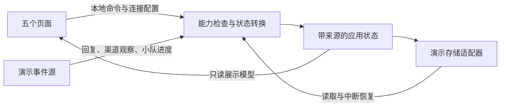

# Orangutan 桌面端技术需求

状态：浏览器交互原型已实现于 [apps/desktop](../../apps/desktop/README.md)。本文拥有
桌面产品的行为和首版验收范围，不代表模拟能力已接入运行时。首版面向 Linux 桌面
使用场景；原生封装及真实运行时接入仍须按 [计划指南](../PLANS_GUIDE.md) 独立实施。

## 1. 产品定位与交付范围

Orangutan 是运行在本电脑上的通用助手。不同真实使用者可以通过不同消息渠道
向它提出请求；桌面自身也是一个交互入口，并提供其他渠道活动的只读观察视图。
产品支持日常问答、文件处理和需要分工的复杂任务，不围绕单一研究、编程或整理流程设计。

各渠道会话像共享工作环境中的独立成员：共用工作区和基础记忆，保留各自的上下文。
请求者身份用于区分来源与个人记忆，不引入组织、管理员层级或成员角色管理界面。
多 agent 小队指助手为任务组织的执行成员，与发来请求的真实使用者分别建模。

首版必须交付：

- 助手、任务、连接、记忆、设置五个可交互页面。
- 桌面对话、流式回复演示、工具步骤、审批、成果预览及自动组织的小队。
- QQ、Telegram、飞书的模拟连接和只读渠道活动预览。
- 中文与英文、浅色与深色主题、跟随系统主题。
- 可重现的演示状态、本地保存的历史与设置、启动和中断恢复体验。

模型回复、工具执行、文件变更、渠道连接和远端操作均由演示数据驱动。
自由输入应得到明确的模拟反馈；演示覆盖多类请求，不要求用户只能点击预设任务。
界面持续提供简洁的演示模式标识，不要求真实账号、API Key 或扫码登录。

本阶段不交付原生安装包、真实模型或渠道接入、真实文件写入、后台常驻服务、
开机自启、跨渠道身份合并，也不承诺浏览器原型具有实际 agent 执行能力。

## 2. 已有基础与目标能力的区别

当前实现以 [运行状态](../STATUS.md)、[架构](../ARCHITECTURE.md) 和各契约为准。
以下表格仅定位桌面后续接入需要复用或补充的边界。

| 领域 | 已有基础 | 原型目标及后续缺口 |
| --- | --- | --- |
| 宿主与会话 | `RuntimeAssembly`、`HttpProviderBackend`、`AgentSession` 可组合，支持流式观察、续聊和取消 | 尚无桌面宿主；统一会话列表和 UI 事件适配需后续建设。 |
| Telegram | 已有面向一个允许用户私聊的可部署宿主 | 多请求者接入、桌面观察及渠道交互审批不是既有能力。 |
| QQ | 有扫码凭据绑定、认证及 transport 基础、有限的 live evaluator | 凭据绑定不等于长期在线消息服务，桌面连接管理尚不存在。 |
| 飞书 | 有消息适配器与出站 transport 绑定 | 完整认证入站、凭据生命周期与可部署宿主仍需补充。 |
| 记忆与工作区 | 有 scoped memory、持久化会话和文件工具 | 跨宿主公共记忆与个人记忆组合，是新的目标模型，不能直接视为已共享。 |
| 任务与小队 | 有按 owner 隔离的任务、团队与取消机制 | 桌面统一观察视图需另建；运行中任务和小队不保证跨进程恢复。 |
| 权限 | 有规则判断、审批 hook 与有作用域的 grants | 渠道审批交互要由相应宿主接入，桌面不代为实现审批 consumer。 |

对应的契约入口：[宿主组合](../design-docs/bootstrap-runtime.md)、
[消息渠道](../design-docs/messaging-channels.md)、[记忆](../design-docs/memory-system.md)、
[小队](../design-docs/agent-teams.md)、[权限](../design-docs/permissions-and-hooks.md)。
核心受支持环境仍由 [构建系统](../BUILD_SYSTEM.md) 定义；网页可运行不代表核心已跨平台。

## 3. 会话、身份与共享模型

### 3.1 用复合键区分入口中的会话

产品层采用二元组组成的复合键：

```text
ConversationKey = (ConnectionId, ConversationLocator)
ConnectionId   = 一个确定平台与接入账号的连接身份
ConversationLocator = 该连接内的聊天标识，包含需要区分的聊天类型与线程
RequesterKey   = (ConnectionId, SenderId)
```

连接名称、联系人昵称只是展示值，不能作为唯一标识。同一平台接入多个账号时必须区分。
QQ 上两个人的私聊是不同会话；同一个人使用 QQ 与 Telegram 时也保持不同的请求者身份，
个人记忆不自动合并。桌面自身使用独立的本地连接与对话标识。

后续与现有 `channel::Conversation` 对接时，映射必须保留 platform、account、kind、
chat、thread 的完整区分能力，不能把底层路由压缩成平台名与昵称。
会话路由键与运行时 `session_id` 分开：同一聊天入口可以开始新的 session，并保留旧历史。
会话与请求者也分开记录，不通过私聊示例假定二者永远一一对应。

### 3.2 数据归属

| 对象 | 必须表达的归属与关联 |
| --- | --- |
| 连接 | 平台、接入账号标识、显示名、连接状态。 |
| 请求者 | 请求者复合键、显示名；无自动跨渠道关联。 |
| 会话 | 会话复合键、当前 session、来源入口及参与请求者。 |
| 消息 | 消息 ID、会话、session、发送者、内容、时间及发送状态。 |
| 任务 | 任务 ID、来源会话与请求者、状态、执行尝试、成果及小队关联。 |
| 小队成员 | agent 身份、所属任务、角色、工作状态与结果摘要。 |
| 审批 | 审批 ID、所属入口和任务、待确认操作、对象、状态；不能仅凭 ID 跨入口操作。 |
| 记忆 | 记录 ID、共享或个人作用域、个人记录所属请求者、来源、内容与更新时间。 |
| 通知 | 通知 ID、来源事件、会话及任务关联、已读状态。 |

历史上下文只进入所属会话；公共基础记忆可以跨入口使用，个人偏好按请求者隔离。
公共知识、工作区约定和公共资料引用必须明确标为共享，不因“保存到记忆”就自动公开。
各入口使用同一工作区，具体文件操作仍受各自的运行时权限和文件系统边界约束。
桌面预览一段渠道历史，不会把它自动加入桌面主对话的上下文。

## 4. 桌面与渠道的操作边界

| 行为 | 桌面自身会话 | 外部渠道会话在桌面中的视图 |
| --- | --- | --- |
| 查看消息、工具步骤与成果 | 支持 | 只读预览。 |
| 输入、发送、修改消息或接续对话 | 支持本地输入与发送 | 不提供输入框或代发、修改入口。 |
| 查看任务、小队和执行状态 | 支持 | 只读预览。 |
| 停止、重试任务或调整执行 | 支持本地任务控制 | 不提供操作；在原渠道进行。 |
| 批准、拒绝操作 | 仅处理本地审批 | 只显示状态；在原渠道处理。 |
| 配置会话权限 | 仅影响桌面自身会话 | 不提供渠道权限配置或覆盖。 |
| 通知 | 可查看并跳转到关联内容 | 可查看并跳转到只读预览。 |

外部渠道回复只回到原会话。桌面通知是观察副本，不构成第二次回复、跨渠道转发或代操作。
查看或标记通知已读不得触发发送、审批、重试或任务状态修改。

连接页可以管理连接的启停状态；这是通信连接的生命周期操作，不授予桌面对渠道任务的
执行权。断开连接不能伪装为“任务已取消”，也不能把待审批操作自动变成允许。
应用整体关闭导致执行停止，遵循第 6 节，不等价于桌面提供跨渠道逐任务控制。

该边界同时约束按钮、快捷键、批量操作和命令处理。原型中隐藏按钮之外，状态更新入口也
必须拒绝桌面对外部会话的写操作。接入真实服务后，此约束还须由宿主验证，不能只依赖 UI。

## 5. 页面与主要流程

### 5.1 助手

默认打开桌面自己的主对话，支持随口提问和交代事情；复杂工作形成独立任务。
左侧包含五个页面入口及按来源分组的会话，显示联系人、未读标记和最近活动。
中间展示对话、当前工具步骤和紧凑的协作卡片；右侧在需要时展开成果或任务详情。
切换到渠道会话时，来源和只读状态始终可见，输入区由只读说明替代。

本地交互覆盖输入、发送、模拟流式回复、执行中状态、停止、审批、失败重试和成果预览。
同一本地 session 正在执行时，不重复提交另一个执行；不同会话的状态分别维护。
工具卡片显示操作摘要、目标和状态，详细信息按需展开。
成果至少演示 Markdown 文档、文本文件及文件变更预览；不对本机真实文件产生写入。

审批卡显示具体操作、作用对象与影响，允许或拒绝后状态更新且不重复提交。
拒绝必须成为可见的执行结果，不能继续演示被拒绝的效果。
渠道的待审批卡只有详情和原渠道处理提示。

### 5.2 任务

提供跨入口任务列表，可按状态、来源筛选，并进入对应会话或成果。
任务详情展示请求摘要、发起者、进度、执行步骤、小队和最终结果。
本地任务允许停止或重试；渠道任务全部只读，包括页面中的批量操作。

小队由助手按需组织，用户不必先配置角色或挑选团队。
成员卡片显示角色、负责事项、工作状态和结果摘要，支持展开查看；主助手负责汇总。
演示中包含并行执行及成员失败的情况，不把每次简单问答都变成多 agent 任务。

### 5.3 连接

提供 Telegram、QQ、飞书连接卡片，展示接入账号、连接状态和最近活动。
连接流程使用明确的示例配置，演示连接中、已连接、已断开和错误后的重新连接。
账号配置保存、认证结果和消息传输在线状态分别表达，不能因填入配置就显示真实已在线。
入口可跳转到该连接下的会话预览；无组织成员管理或渠道权限管理页面。

### 5.4 记忆

提供搜索、作用域与来源筛选、详情、编辑、删除和记忆开关。
记录显示共享或个人归属、来源会话或资料及更新时间；编辑时保留明确的作用域。
自动积累通过演示事件体现，不保证每次对话都生成长期记录。
进行中的任务进度保留在任务中，不自动转为公共长期记忆。

删除只作用于明确选择的记录，不连带清除会话或工作区。关闭记忆不删除既有记录。
记忆管理不修改渠道消息历史、任务状态或权限；个人记录不得在编辑时隐式转为共享。
接入真实记忆时，删除、修订与保留规则遵循现有记忆和存储契约。

### 5.5 设置与通知

设置包含语言、主题、通知偏好、示例模型配置和桌面自身的权限选项。
模型配置用样例值展示状态，不保存真实密钥；不把只有枚举名的协议标为已实现。
主题默认跟随系统，界面默认中文；手动选择会保存，切换后保留当前会话与任务状态。
翻译覆盖导航、状态、错误、审批、设置和无障碍名称；历史消息不随语言切换被改写。

通知展示来源、请求者和事件摘要，支持已读与跳转。
覆盖任务完成、失败、待审批及连接异常；同一来源事件不得重复生成相同通知。
原型使用应用内通知，系统级通知授权和关闭后的推送不属于首版范围。

## 6. 状态与生命周期

下表是原型展示状态，后续宿主需显式映射到运行时状态，不要求修改核心枚举。

| 对象 | 展示状态 |
| --- | --- |
| 连接 | disconnected、connecting、connected、error。 |
| 执行 | queued、running、awaiting_approval、cancelling、completed、failed、cancelled、interrupted。 |
| 审批 | pending、approved、rejected、expired、cancelled。 |

正常执行从排队进入运行，按需等待审批，随后完成或失败。拒绝不能产生批准后的效果。
停止先进入取消中，清理完成后才显示已取消；旧执行的迟到事件不得把终态改回运行或完成。
重试创建新的执行尝试，保留旧结果；切换会话和页面不重置执行或重复触发任务。

目标桌面应用启动时才运行助手并建立连接，关闭时停止入站、断开连接、取消并等待工作清理。
不提供托盘驻留、独立 daemon 或关闭窗口后继续执行的模式。
原型中的应用生命周期是当前页面实例；开发服务器仍运行不意味着助手仍在线。

历史消息、设置、记忆和已完成成果保存到独立的演示存储。
刷新、关闭或崩溃后的新页面不得恢复旧定时器，也不能将旧连接直接当作仍在线。
恢复快照时，将未结束的执行标为已中断，旧待审批标为失效；重新运行必须显式发起。
不能依赖 `beforeunload` 成功写入才识别中断，应在正常状态变更时保存足够的恢复信息。
关闭期间不模拟收到消息或自动完成任务。

演示按单个活动页面实例设计，不承诺多个标签页共享一个持续执行的 agent。
多实例的运行所有权和真实渠道重连、积压消息处理属于后续宿主接入范围。

## 7. 视觉与交互质量

整体采用温暖工作室风格：暖白或暖炭黑底色、猩猩橙强调、少量森林绿、
简洁的猩猩轮廓图标、舒展排版、轻量圆角及克制动效。
特色来自助手的持续存在感、清晰的协作过程与成果呈现。
主要界面不堆叠运行时类名、协议字段或调试日志。

- 用设计 token 管理颜色、间距、字体、圆角和动效，完整覆盖双主题。
- 页面缩窄时折叠侧栏和详情面板，保持对话和主要操作可用；首版不增加手机端产品形态。
- 所有操作支持键盘焦点；弹层正确管理焦点，关闭后返回触发处。
- 状态以文字和图标共同表达，不能只靠颜色区分；文本与控件保持清晰对比。
- 尊重减少动画的系统偏好，避免无意义的循环动画。
- 空白、加载、失败、断开、只读与长内容溢出均有完整呈现。

参考 [Claude Cowork 的任务与成果布局](https://claude.com/product/cowork)、
[Jan 的进度与文件呈现](https://jan.ai/docs/desktop/cowork)，以及
[Cherry Studio 的模型配置组织](https://github.com/CherryHQ/cherry-studio)。
参考用于信息组织和交互取舍，不要求复制品牌、文案或整套界面；Jan Cowork 是预览能力。

## 8. 原型技术设计

采用 React、TypeScript 和 Vite，前端作为独立的可选应用目录建设。
纯函数负责可见能力、筛选、来源关联和状态转换；定时器、演示事件、浏览器存储与 UI
订阅作为明确的效果边界。只建立当前原型需要的模块，不先建设通用插件或多宿主框架。



关键实现约束：

1. 将演示事件源与页面分开，使后续真实宿主可提供相同用途的观察数据；本阶段不定义
   未验证的 HTTP、WebSocket 或 IPC 协议。
2. 本地用户命令与渠道观察事件分别处理。演示源可以更新渠道执行状态，桌面操作不能
   借同一更新入口发送消息、批准操作、停止或重试渠道任务。
3. 事件携带所属会话、session、任务和执行尝试标识；异步更新按归属应用，
   不能写入“当前选中会话”。来源标识不依赖可变的显示名称。
4. 演示计时器和订阅由应用实例统一持有，关闭与重置时清理，状态恢复不重放副作用。
5. 存储内容限于演示数据，使用专用键空间，读取时验证结构。
   无法读取、格式错误或写入失败时提供恢复提示，不静默清除已有快照或声称保存成功。
6. 主题、语言与页面状态解耦。页面不因切换语言、主题或展开面板重建执行。
7. 消息和成果按不可信内容渲染；Markdown 不执行原始脚本或任意 HTML。
8. 新前端依赖必须在 [依赖规则](../rules/libraries.md) 中登记用途、许可证、边界和构建成本，
   并提交锁文件；不向默认 C++ 构建引入 Node、GUI 或浏览器依赖。

原型目录为 `apps/desktop`，依赖版本由该目录的 package manifest、锁文件与依赖规则共同记录。
[使用说明](../../apps/desktop/README.md) 提供安装、开发、构建、演示场景和验证命令。
Markdown 按需加载，演示连接结果可在配置中选择；纯命令处理与演示观察事件分开调用。

## 9. 验收标准

| 编号 | 可验证的结果 |
| --- | --- |
| D01 | 五个页面及主要详情可进入、返回，刷新后恢复已保存数据，首次使用有可理解的演示内容。 |
| D02 | 本地输入触发模拟回复和执行；状态、审批、停止、失败与重试有可观察结果。 |
| D03 | 两个渠道连接、两个同平台账号和不同联系人不会混淆消息、任务或个人记忆。 |
| D04 | 渠道预览没有输入、代发、修改、审批或执行控制入口；快捷键和命令入口同样拒绝这些操作。 |
| D05 | 渠道结果只更新原会话；桌面通知跳转到正确预览，标记已读无其他副作用，重复事件不重复通知。 |
| D06 | 本地批准与拒绝各走通一次；拒绝后无被拒绝操作的模拟效果；渠道待审批只能观察。 |
| D07 | 小队能展示成员分工、并行进度、成员失败及主助手汇总，来源为渠道时全程只读。 |
| D08 | 连接成功、断开与失败可演示；连接配置不覆盖渠道权限，断开不冒充任务取消。 |
| D09 | 记忆可搜索、筛选、修改和删除；个人与共享作用域明确，关闭记忆保留原记录。 |
| D10 | 刷新或重新打开后，未完成执行标为中断，旧审批失效，无关闭期间完成或自动继续的假象。 |
| D11 | 快速切换会话、停止后迟到事件、同一本地会话重复提交，都不会串话或复活旧执行。 |
| D12 | 中英文、明暗及跟随系统主题覆盖全部页面和状态；切换不丢失当前输入与运行状态。 |
| D13 | 在 Linux 浏览器中检查宽、窄桌面窗口及键盘操作，无关键内容遮挡，减少动画设置生效。 |
| D14 | Markdown/成果预览不执行内容中的脚本；存储失败可见，损坏快照不会被静默覆盖。 |
| D15 | 无需真实凭据可复现演示；没有真实消息发送、模型调用、文件写入或后台助手进程。 |

验证使用与变更相关的类型检查、前端构建及行为测试，并运行 `make ci`。
重点测试来源隔离、只读能力、审批、通知幂等与中断恢复，不用镜像组件实现的测试代替行为验证。
视觉与键盘交互需实际打开页面检查。若后续涉及 C++，按受影响库运行构建和测试；
`make ci` 本身不构建 C++，也不替代独立的前端检查。

## 10. 后续真实接入的独立工作

原型验收不等于真实桌面服务验收。真实接入需另立完整实施切片，并更新各自的契约文档：

- 通过 `oran-bootstrap` 组合宿主，建立 UI 与运行时观察事件的有界映射及关闭时的取消、join。
- 建立可枚举的会话和任务观察视图；保留既有 owner 校验，不能为预览而伪造渠道身份或放宽权限。
- 为各渠道实现认证入站、多请求者会话路由、原路出站和其自身的审批交互。
  桌面观察权限不能变成渠道执行授权。
- 明确公共与个人记忆组合、请求者作用域和来源记录，保留既有用户数据与原始历史。
- 确定渠道连接管理、重连、未投递消息及中断任务的恢复契约。
- 再确定 Linux 桌面封装、凭据保管和安装方式；继续遵守关闭即停止的产品生命周期。

这些事项用于标明原型的接入边界，不扩大本阶段范围，也不提前变更现有运行时契约。
